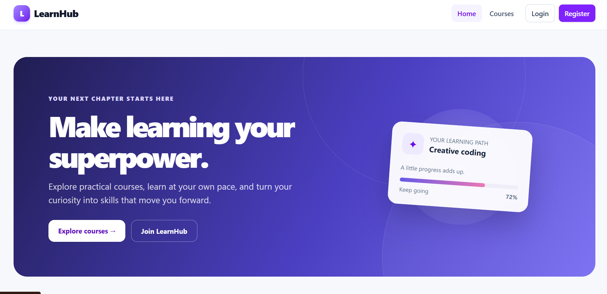
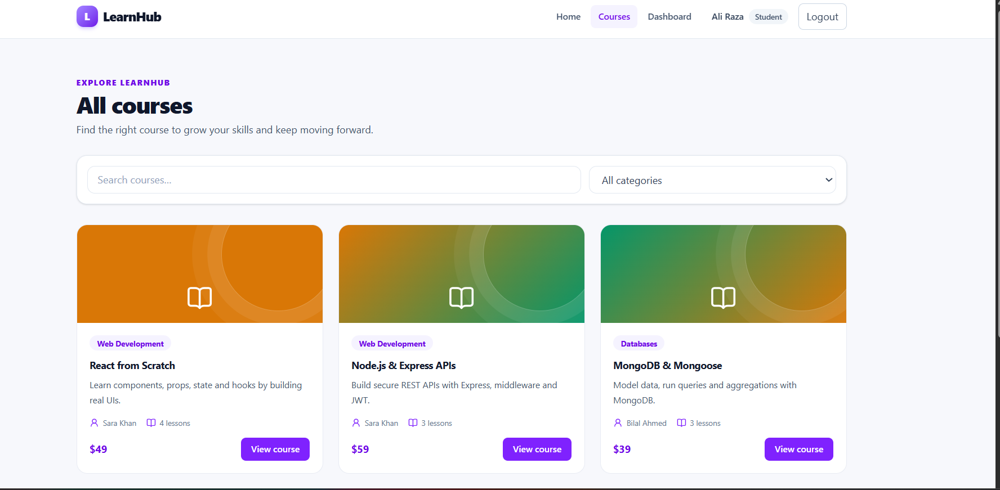
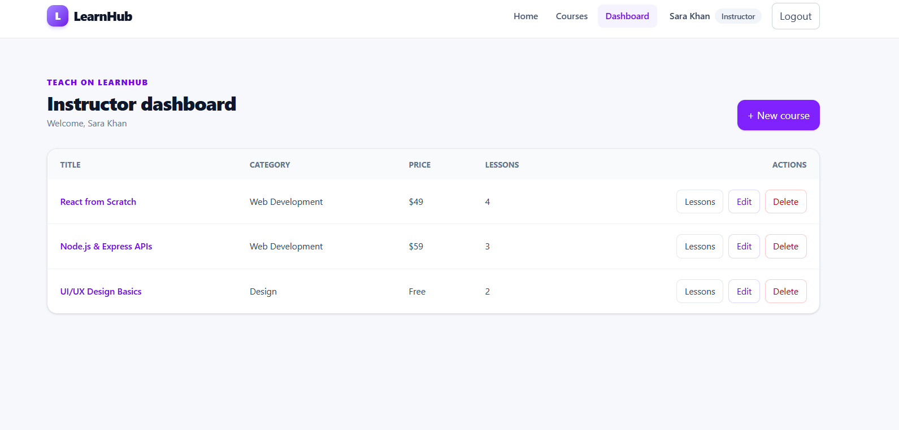
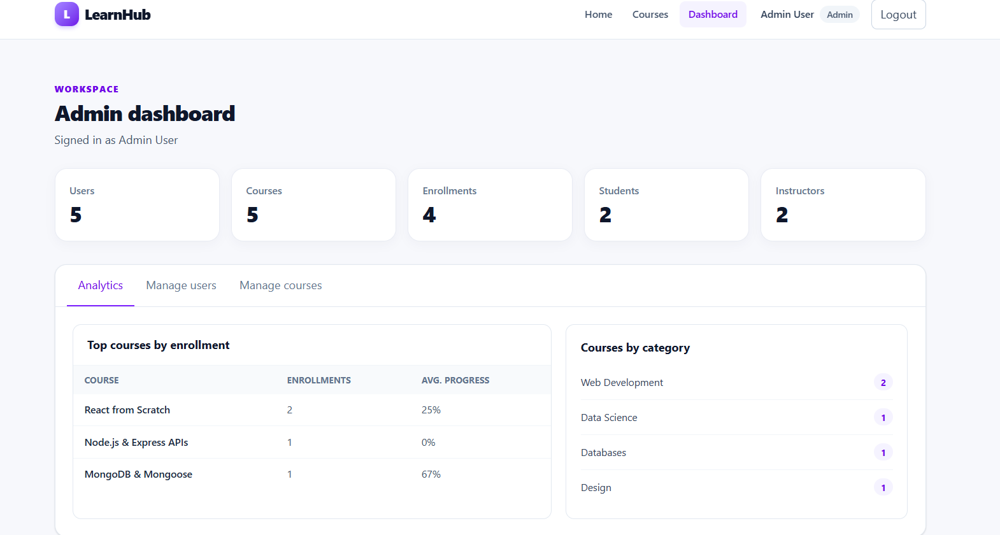
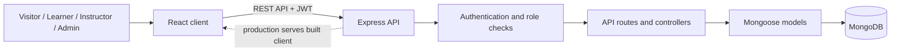

# LearnHub

**A full-stack learning platform for discovering courses, learning at your own pace, and managing online classrooms.**

LearnHub is a MERN-stack Learning Management System (LMS). Learners can explore and enroll in courses, instructors can publish lessons, and admins can manage the platform.



## At a glance

- **Learners:** search courses, enroll, view lessons, and track progress.
- **Instructors:** create and manage courses and lessons.
- **Admins:** manage users and courses and review platform analytics.
- **Responsive UI:** browse on desktop or mobile.
- **Authentication:** JWT-based sessions with role-based access control.

## Visual tour

| Explore courses | Instructor workspace |
|---|---|
|  |  |

| Admin analytics | Mobile experience |
|---|---|
|  |  |

## Architecture



## Technology

| Layer | Technologies |
|---|---|
| Frontend | React, Vite, React Router, Axios, Tailwind CSS |
| Backend | Node.js, Express |
| Database | MongoDB, Mongoose |
| Authentication | JSON Web Tokens, bcryptjs |

## Run locally

### Prerequisites

- Node.js `20.19+` or `22.12+`, and npm (required by the current Vite version)
- MongoDB running locally, or a MongoDB Atlas connection string

### 1. Configure and start the backend

In PowerShell:

```powershell
cd backend
npm ci
Copy-Item .env.example .env
```

Edit `backend/.env` and set `MONGO_URI` and a private, randomly generated `JWT_SECRET`. Keep this file local; never commit it.

```powershell
npm run dev
```

The API starts at `http://localhost:5000`.

### 2. Start the frontend

Open a second terminal:

```powershell
cd frontend
npm ci
npm run dev
```

Open `http://localhost:5173`. During development, Vite proxies `/api` requests to the backend.

### Optional: load sample data

With MongoDB configured, run this from the `backend` directory:

```powershell
npm run seed
```

The seed script creates demo accounts for local development. Do not run it against a production database or use its demo credentials on a public deployment.

## Environment variables

Use [`backend/.env.example`](backend/.env.example) as the backend template. For a separately hosted frontend, set `VITE_API_URL` at build time using [`frontend/.env.example`](frontend/.env.example).

| Variable | Used by | Purpose |
|---|---|---|
| `PORT` | Backend | HTTP port (defaults to `5000`) |
| `MONGO_URI` | Backend | MongoDB connection string |
| `JWT_SECRET` | Backend | Private signing secret for authentication tokens |
| `JWT_EXPIRES_IN` | Backend | Token lifetime (defaults to `7d`) |
| `CLIENT_URL` | Backend | Allowed frontend origin(s), comma-separated |
| `NODE_ENV` | Backend | Set to `production` for a deployment |
| `VITE_API_URL` | Frontend | Base URL of a separately hosted API; leave empty for local proxying |

Never put database credentials or private secrets in frontend variables: Vite embeds `VITE_*` values in client-side assets.

## Production deployment

The backend can serve the built frontend, allowing both to run as one Node.js service. From the repository root, use:

```powershell
npm --prefix frontend ci
npm --prefix frontend run build
npm --prefix backend ci
npm --prefix backend start
```

Configure the hosting service to build the frontend and start the backend with `npm --prefix backend start`. Set `NODE_ENV=production`, `MONGO_URI`, and a strong `JWT_SECRET` in the host's environment settings. Set `CLIENT_URL` to the frontend origin when needed. Use a managed MongoDB deployment for production; do not commit environment files.

If frontend and backend are hosted separately, set `VITE_API_URL` to the deployed API URL when building the frontend and configure `CLIENT_URL` on the backend to allow the frontend's origin.

## API overview

All endpoints are prefixed with `/api`.

| Method | Endpoint | Access |
|---|---|---|
| `POST` | `/register`, `/login` | Public |
| `GET` | `/me` | Authenticated |
| `GET` | `/courses` and `/courses/:id` | Public; lesson content is access-controlled |
| `POST` | `/courses` | Instructor or admin |
| `PUT`, `DELETE` | `/courses/:id` | Course owner or admin |
| `POST` | `/courses/:id/lessons` | Course owner or admin |
| `DELETE` | `/courses/:id/lessons/:lessonId` | Course owner or admin |
| `POST` | `/enroll` | Student |
| `GET` | `/my-courses` | Student |
| `PUT` | `/my-courses/:courseId/progress` | Student |
| `GET` | `/admin/users`, `/admin/analytics` | Admin |
| `PUT`, `DELETE` | `/admin/users/:id/role`, `/admin/users/:id` | Admin |

## Tests and checks

Run the backend API tests:

```powershell
cd backend
npm test
```

The tests use a separate `learnhub_test` database. Ensure the test MongoDB instance is available before running them.

Build and lint the frontend:

```powershell
cd frontend
npm run build
npm run lint
```
